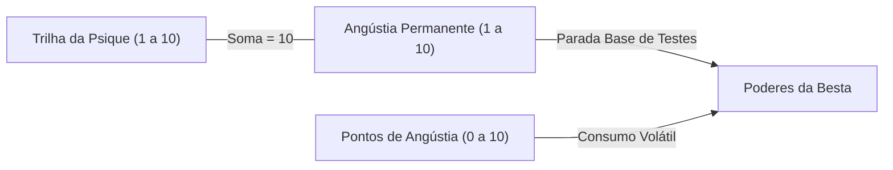

# As Regras de Ouro 2.0 (E ainda chove)
## Módulo 08: O Guia da Besta (Manual Oficial do Adversário Interior)

> *"Cada personagem abriga seu pior inimigo dentro do seu próprio coração. Enquanto o jogador, a quem chamaremos de Psique, se esforça para representar a personalidade original do personagem, a face que ele exterioriza para o mundo, a Besta é o sussurrante arauto do pecado e da tentação. É toda a malícia e egoísmo em sua alma, com uma voz que não pode ser silenciada."*

---

### 1. Capítulo I: Abandonai Todas as Esperanças...

#### 1.1 A Besta e a Psique
A Besta não pode ser classificada como sendo sempre má, mas ao menos negativa e destrutiva. Ela é uma combinação do clássico *Id* Freudiano com o demônio pessoal medievalista. A Besta é certamente a pior parte em ser um Cainita: afinal, vozes externas podem ser ignoradas ou caladas, enquanto nada se pode fazer contra uma voz que vem de dentro de você.

A Besta é o único denominador comum, implacável e inevitável de todos os Cainitas, mas ainda assim única em cada pessoa. Egoísta em seus desejos, a Besta é toda a malícia, ódio, cobiça e trevas que fazem parte de todos nós, porém mais refinada e destilada para ganhar vida própria.

#### 1.2 O Papel do Guia da Besta
Enquanto você pode até conhecer o lado negro de seu personagem, certamente não pode controlá-lo. Por isso, a tarefa de guiar a sua Besta é entregue a **outra pessoa dentro do grupo de jogo**. Ele será o seu **Guia da Besta**.
- Isso garante o conflito autêntico entre o jogador da Psique do personagem contra a própria Besta interior, demonstrando a clara distinção de perspectivas de cada um desses papéis.
- Paralelamente, todos se divertem: assim como alguém controlará a sua Besta, você fará o mesmo com a Besta de outro colega. Isso balanceia a mesa e mantém todos os jogadores ativos e compenetrados em todas as cenas da narrativa.
- Durante uma crônica de *Vampiro: As Regras de Ouro*, cada participante interpreta simultaneamente **dois papéis**: a sua própria **Psique** e a **Besta** de um companheiro.

#### 1.3 Responsabilidades, Técnicas e Maturidade
- **Confiança e Cumplicidade:** No início de cada sessão, os jogadores devem conversar por alguns minutos sobre seus personagens. A Psique expõe ao Guia da Besta seus planos e anseios, enquanto o Guia pontua as fraquezas e tentações que explorará. Ambos devem ter maturidade para separar o conhecimento de jogador do conhecimento do personagem.
- **Tonalidade de Voz e Máscara:** Recomenda-se ao Guia usar uma voz sussurrada e próxima ao ouvido quando falar pela Besta, para que fique evidente quem está se manifestando. Alguns grupos utilizam pequenas máscaras que são erguidas sobre a face quando a Besta assume a palavra.
- **Intervenções Cirúrgicas:** A Besta não deve interromper a Psique a cada minuto. As Bestas mais aterrorizantes atacam sem avisar, aguardando o momento em que a Psique está sem opções. Qualidade e precisão dramática superam a constância cansativa.
- **O Narrador como Guia:** Quando dois jogadores que guiam a Besta um do outro estiverem em cena dialogando intensamente, o Narrador pode assumir temporariamente a Besta de ambos para evitar confusão mental. Da mesma forma, em situações de Frenesi mútuo ou ausência de um jogador, o Narrador assume a condução da Besta.

#### 1.4 Maneiras de Organizar o Jogo
O grupo e o Narrador podem escolher uma das seguintes dinâmicas para a distribuição dos papéis:
1. **Predador e Presa (Padrão Oficial):** Os jogadores organizam-se em círculo. Cada jogador é o Guia da Besta do participante sentado à sua esquerda.
2. **Identidades Autônomas:** Para grupos numerosos. Alguns participantes atuam exclusivamente como Psiques e outros exclusivamente como Guias da Besta.
3. **Hordas:** Vários jogadores atuam conjuntamente como Guias da Besta de um único personagem de grande importância dramática, formando um coro ensurdecedor de vozes em sua mente.
4. **Príncipe das Trevas:** Um jogador veterano atua como a Besta de toda a mesa de novatos, encarnando o próprio tentador supremo.
5. **Histórias Paralelas:** O Narrador divide a mesa em dois grupos com arcos entrelaçados: enquanto um grupo atua ativamente como Psique, o outro personifica as Bestas dos companheiros.

#### 1.5 Os 6 Mandamentos do Guia da Besta
> 1. **Não moleste ou embarace o jogador cuja Besta você guia.** O seu alvo é apenas o personagem dele, nunca a pessoa do jogador.
> 2. **Escolha bem os momentos para se manifestar.** Uma Besta excessivamente ativa torna-se banal e irritante em vez de dramática.
> 3. **Não sacrifique o seu próprio personagem para ser um bom Guia.** Se você está gastando mais tempo como Besta do que cuidando de sua própria Psique, repense sua postura.
> 4. **Se você conhece fobias, traumas e gatilhos reais do jogador, JAMAIS os utilize no jogo.** Um bom Guia atua com arte sem explorar fraquezas pessoais do colega.
> 5. **Entenda onde termina o seu personagem e onde começa a Besta que você guia.** Não misture os papéis nem use informações da Besta para beneficiar seu personagem.
> 6. **Tenha em mente que tanto a Psique quanto a Besta são partes de uma história maior.** Todas as ações devem convergir para o drama, o horror pessoal e a diversão coletiva.

---

### 2. Capítulo II: Nem Só de Pão (As Motivações da Psique)

Para escapar ao profundo tédio e à frieza da imortalidade, os cainitas precisam se apegar desesperadamente a sonhos e razões de viver. Um vampiro sem motivos entrega voluntariamente sua jugular para as presas da Besta. Na ficha do personagem, as motivações da Psique são representadas por **Paixões** e **Grilhões**.

#### 2.1 Paixões da Psique
As Paixões representam desejos, projetos, ideais ou prazeres que movem a existência do cainita (ex: *"Construir um império financeiro / Ambição"*, *"Destruir o Príncipe / Vingança"*, *"Dançar sob a lua / Alegria"*).

- **Pontos de Criação:** A Psique recebe **7 pontos** para distribuir entre duas ou mais Paixões.
- **Escala de Intensidade (1 a 5):**
  - `Nível 1`: Anseio menor. Apenas desejável.
  - `Nível 2`: Objetivo menor e não-vital. Correria riscos e faria sacrifícios moderados por ele.
  - `Nível 3`: Objetivo primário e importante. Poria vidas em risco ou mataria por ele.
  - `Nível 4`: Objetivo imperioso e vital. Correria risco de morte por ele.
  - `Nível 5`: Amor verdadeiro / Convicção suprema. Sacrificaria voluntariamente a própria não-vida por ele.

#### 2.2 Grilhões da Psique
Enquanto as Paixões são motivações ativas, os **Grilhões** são os elos emocionais passivos: pessoas, lugares, animais ou objetos aos quais o personagem nutre profundo afeto, apego ou reverência (ex: *"Meu relógio de bolso / Saudade do pai"*, *"Minha esposa mortal / Amor"*, *"Meu puro-sangue / Gratidão"*, *"Minha capela / Devoção"*).

- **Pontos de Criação:** A Psique recebe **7 pontos** para distribuir entre dois ou mais Grilhões (escala de 1 a 5).
- **Notação na Ficha:** Deve-se registrar o nome do ente/objeto acompanhado do sentimento que ancora a conexão (`Nome / Emoção`).

---

### 3. O Mal Secreto: As Motivações da Besta

As armas fundamentais do Guia da Besta são os desejos reprimidos, recalcados e inconfessáveis da alma do personagem. Eles são representados na ficha pelas **Paixões Obscuras** e pelos **Grilhões Obscuros**.

> [!IMPORTANT]
> As Paixões Obscuras e os Grilhões Obscuros **são definidos pelo Guia da Besta**, com a aprovação do Narrador, e **NÃO** pela Psique!

#### 3.1 Técnicas para Criação de Paixões Obscuras
O Guia da Besta utiliza uma das seguintes abordagens psicológicas para conceber as Paixões Obscuras do personagem:
1. **Revolta:** Inversão direta de uma Paixão imposta por terceiros (ex: Paixão de *"Manter negócios da família / Ambição"* $\to$ Paixão Obscura de *"Arruinar o patrimônio da família até a falência / Revolta"*).
2. **Exagero:** Levar uma Paixão nobre ao extremo da catástrofe e do fanatismo destrutivo (ex: Paixão de *"Proteger a filha / Carinho"* $\to$ Paixão Obscura de *"Manter a filha encarcerada e isolada do mundo / Superproteção sádica"*).
3. **Negação:** O personagem adota uma postura pública extremista justamente para reprimir um desejo proibido interior (ex: Paixão homofóbica violenta para esconder a Paixão Obscura de *"Desejo por pessoas do mesmo sexo / Lascívia reprimida"*).
4. **À Qualquer Custo:** O maquiavelismo moral de usar qualquer meio repugnante para atingir a meta da Paixão (ex: Paixão de *"Ser o melhor aluno da turma / Vaidade"* $\to$ Paixão Obscura de *"Prejudicar e sabotar os colegas / Inveja"*).
5. **Válvula de Escape:** A Paixão atua como desculpa comportamental para saciar algo hediondo (ex: Babá com Paixão de *"Cuidar de crianças"* usada para encobrir impulsos doentios).
6. **Prelúdio:** Exploração de cicatrizes e segredos da vida mortal do personagem anteriores ao Abraço.

#### 3.2 Grilhões Obscuros
São coisas, locais ou pessoas que despertam ressentimento, culpa, amargura, vergonha ou trauma profundo. O personagem quer mantê-los longe, mas é incapaz de se desvencilhar de sua lembrança (ex: *"O túmulo do pai falecido / Culpa"*, *"A casa onde a mãe foi assassinada / Pavor"*, *"O rival da infância / Ódio"*). O medo puro não gera Grilhão Obscuro; deve haver rancor, amargura ou culpa associados.

#### 3.3 Pontuação de Criação por Etária
O Guia da Besta recebe pontos para distribuir entre Paixões Obscuras e Grilhões Obscuros conforme a idade vampírica da Psique:

| Etária do Personagem | Pontos em Paixões Obscuras | Pontos em Grilhões Obscuros |
| :--- | :---: | :---: |
| **Neonato** | 4 pontos | 4 pontos |
| **Neófito** | 7 pontos | 7 pontos |
| **Ancilla** | 10 pontos | 10 pontos |

---

### 4. Capítulo III: Caindo nas Garras da Besta (O Frenesi)

Quando os impulsos reprimidos transbordam a capacidade de contenção moral da Psique, irrompe o **Frenesi**.
- Durante o Frenesi, o jogador da Psique **perde o controle de seu personagem** e o **Guia da Besta assume a interpretação física e verbal do corpo do vampiro**.
- **Nota Fundamental:** O personagem **não é possuído por uma entidade externa**. É a sua própria mente em estado de abandono ético e fúria selvagem. Quando o Frenesi termina, o vampiro recorda-se de cada ato, palavra e atrocidade que cometeu.

#### 4.1 Fisiologia do Frenesi
O estado frenético manifesta transformações somáticas aterrorizantes:
- Vasos sanguíneos oculares dilatam-se, tingindo os olhos de vermelho sangrento.
- O coração morto volta a bater em palpitações dolorosas que ressoam nos ouvidos.
- A respiração ressurge como um arquejo ofegante inútil e a temperatura corporal sobe para até 30 °C.

---

#### 4.2 O Frenesi Selvagem (Ira ou Fome)

O Frenesi Selvagem destina-se à aniquilação física imediata da fonte de provocação ou ao consumo voraz de sangue.

**Vantagens Temporárias durante o Frenesi Selvagem:**
- O vampiro ignora todas as penalidades por ferimento corporais (a menos que seja incapacitado).
- Recebe **$+2$ níveis de bônus em seu Campo Pessoal** contra tentativas de Dominação.
- A fúria catalisa sua força física: **em qualquer teste de Força, o resultado do dado nunca será inferior a 10**.
- O vampiro nunca matará ou destruirá seus próprios Grilhões Obscuros durante o Frenesi (embora possa agredi-los verbalmente).

##### Tabela de Dificuldades: Frenesi por Provocação / Ira
Teste resistido de $\text{Emocional} + \text{Autocontrole}$:

| Provocação / Estímulo | Dificuldade do Teste |
| :--- | :---: |
| Ser maltratado verbalmente | 2 |
| Ser humilhado em público | 4 |
| Ter a própria integridade física ou vida ameaçada | 6 |
| Ser provocado ativamente até a fúria | 8 |
| Ver um ente querido (Grilhão) ser violentamente ameaçado | 9 |
| Ser ostensivamente humilhado e desonrado diante de seus pares | 10 |

##### Tabela de Dificuldades: Frenesi por Fome
Ocorre conforme a reserva de Vitæ diminui criticamente:
- **Reserva em 2 Vitæ:** A Fome emite o **1º Chamado**. O jogador testa $\text{Emocional} + \text{Autocontrole}$:
  - *Sem fonte à vista:* Dificuldade 6
  - *Sente o cheiro de sangue fresco:* Dificuldade 7
  - *Está vendo sangue mortal derramado:* Dificuldade 8
  - *Sente o gosto de sangue nos lábios:* Dificuldade 9
  - *Há uma fonte viva ao alcance dos braços:* Dificuldade 10
- **Reserva em 1 Vitæ:** A Fome emite o **2º Chamado** (retesta nas dificuldades acima).
- **Reserva em 0 Vitæ:** A Fome emite o **3º Chamado**: **Frenesi automático incondicional (sem teste de resistência)**. O vampiro caça e drena a fonte mais próxima até secá-la.

> [!WARNING]
> **Teto de Vitæ e de Trilha:** Em nenhum momento a parada de dados para resistir à Fome pode ser maior que o número atual de Vitæ no corpo, nem maior que o nível atual da Trilha de Iluminação!

**Duração do Frenesi Selvagem:**
- Induzido por Ira: Dura 1 minuto $+ 1$ minuto adicional para cada nível de Angústia Permanente da Besta.
- Induzido por Fome: Dura até que o vampiro atinja uma quantidade de Vitæ no corpo igual ao nível de Angústia Permanente de sua Besta.

---

#### 4.3 O Frenesi Raposa (*Terror de Rötschreck* / Medo Vermelho)

Provocado pelo medo primordial e incontrolável das duas grandes perdições cainitas: **Fogo** e **Luz Solar**.
- O vampiro foge em pânico cego, agredindo com violência qualquer um que tente impedi-lo de se afastar do perigo.
- Possui os mesmos bônus físicos do Frenesi Selvagem.
- **Teste:** $\text{Emocional} + \text{Coragem}$ vs. Dificuldade da Ameaça:

| Ameaça de Fogo ou Luz Solar | Dificuldade |
| :--- | :---: |
| Ameaçado por cigarro aceso | 2 |
| Ameaçado por isqueiro próximo | 3 |
| Ameaçado por jornal ou tocha de papel em chamas | 4 |
| Ameaçado por tocha de madeira acesa | 5 |
| Ameaçado por fogueira de acampamento | 6 |
| Ver a luz solar difusa / obscurecida pelo horizonte | 7 |
| Sofrer queimadura por chama direta | 8 |
| Receber raio de sol diretamente na pele | 9 |
| Ficar encurralado em um edifício em chamas | 10 |

---

#### 4.4 Pondo Rédeas na Besta (Interferência da Psique)
Mesmo quando o Guia da Besta assume o controle do corpo, a Psique pode tentar intervir em momentos críticos (para impedir o assassinato de seu grande amor ou forçar o ataque prioritário contra um inimigo jurado):
- **Teste:** $\text{Emocional} + \text{Nível do Grilhão ou Paixão}$ justificadora vs. $\text{Angústia Permanente da Besta}$.
- *Se a Psique vence:* Proíbe o Guia ou força uma ordem específica durante a cena.
- *Em caso de empate:* A Besta hesita por um instante e repete-se o teste no turno seguinte.
- *Se a Psique falha:* Não consegue intervir e fica impedida de tentar novamente pelo restante da cena.

---

### 5. Na Garganta da Fera: A Economia da Angústia

O Guia da Besta é governado por duas estatísticas fundamentais:

1. **Angústia Permanente (1 a 10):**
   - É o medidor estrutural da força da Besta. É sempre complementar à Trilha de Iluminação do vampiro:
     $$\text{Trilha de Iluminação} + \text{Angústia Permanente} = 10$$
   - Se a Trilha for 7, a Angústia Permanente é 3. Se a Trilha cair para 4, a Angústia Permanente sobe para 6.
   - Atua como a **parada de dados padrão** da Besta em disputas contra a Psique e outros seres.
2. **Pontos de Angústia (0 a 10):**
   - A reserva de energia volátil da Besta (o equivalente à Vitæ para o vampiro). Usada para ativar Flagelos e comprar intervenções sobrenaturais.
   - 0 pontos indica uma Besta adormecida e apaziguada; 10 pontos indica uma Besta saturada e à beira da explosão.

#### Geração de Pontos de Angústia:
- **Praticar Paixão Obscura:** Ganha pontos de Angústia iguais ao **nível da Paixão Obscura** (máximo 1 vez por dia por Paixão).
- **Contato com Grilhão Obscuro:** Ganha pontos de Angústia iguais ao **nível do Grilhão Obscuro** (máx 1 vez por dia por Grilhão).
- **Destruição de Grilhão:** Se o personagem presencia a destruição de um Grilhão (normal ou obscuro), ganha pontos iguais ao nível do Grilhão. Se foi o próprio personagem que o destruiu, **o ganho é dobrado**.
- **Resistir a um Frenesi:** Cada vez que a Psique resiste com sucesso ao Frenesi, a frustração alimenta a Besta com **$+1$ ponto de Angústia**.

#### Perda de Pontos de Angústia:
- **Praticar Paixão Normal:** A Besta perde pontos iguais ao **nível da Paixão** (máx 1 vez por dia).
- **Contato com Grilhão Normal:** A Besta perde pontos iguais ao **nível do Grilhão** (máx 1 vez por dia).
- **Sucumbir ao Frenesi:** Quando o personagem falha em resistir ou se entrega voluntariamente ao Frenesi, a liberação de fúria faz a Besta perder **$-1$ ponto de Angústia**.

---

### 6. As Faces do Mal: Os 5 Simbolismos Arcanos

O Guia da Besta deve escolher um dos cinco **Simbolismos Arcanos**, que definem a personalidade, a estratégia de corrupção, as regras exclusivas de Frenesi e o "Evangelho" da Besta que interpreta:

#### 6.1 O Cordeiro (A Besta da Melancolia e Auto-Indulgência)
- **Filosofia:** Vê o mundo como um calvário injusto de dor e hipocrisia. Seu objetivo é convencer a Psique de que nada vale a pena e que ela deve se entregar ao descanso eterno (induzindo ao suicídio consciente ou à rendição pacífica à Besta). Alvo preferido: atacar Grilhões e Paixões para provar que o amor é uma farsa.
- **Frenesi Selvagem:** Devolve ao mundo o sofrimento com insultos, recriminações e destruição de quem lhe causou ressentimento.
- **Frenesi Raposa:** Desvencilha-se e foge, blasfemando e culpando tudo e todos em delírios paranóicos.
- **Vantagem:** Se a fonte de provocação estiver causando dano físico à Psique, esta sofre $-2$ dados de penalidade em sua parada para resistir ao Frenesi.
- **Desvantagem:** Não suporta a dor física: ao receber 1 ponto de dano agravado ou sofrer choque elétrico/chicotada, o Frenesi do Cordeiro **cessa imediatamente**.
- **O Evangelho do Cordeiro:**
  1. *Quando as coisas parecerem ruins, mostre para a Psique como são ainda piores.*
  2. *Faça o personagem se decepcionar com as coisas amadas.*
  3. *Não machuque o corpo do personagem nem deixe que o machuquem.*
  4. *Torture e machuque a alma do personagem à vontade.*
  5. *Tente sempre convencer o personagem de que ele deve se entregar à Besta.*
  6. *Se a Psique resistir muito, induza-a ao suicídio.*
  7. *No Frenesi, leve sua vingança a tudo o que incomodou o personagem.*

#### 6.2 O Lobo (A Besta da Violência e Crueldade)
- **Filosofia:** Vê o personagem como uma fera a ser adestrada e uma arma afiada contra o mundo. Empurra a Psique para a agressividade, sangue e brutalidade até zerar sua Trilha de Iluminação.
- **Frenesi Selvagem:** Rápido, gracioso, eficiente e quase mudo (rosnados e frases de uma única palavra como *"Morra!"*). Neutraliza obstáculos sem hesitação e abate presas antes de se alimentar.
- **Frenesi Raposa:** Se tiver a fonte do medo ao alcance, desfere um golpe de destruição no primeiro turno antes de fugir em velocidade máxima.
- **Vantagem:** Durante o Frenesi, o dado do personagem **nunca é inferior a 10** tanto em testes de **Força** quanto em testes de **Agilidade**.
- **Desvantagem:** Cessação rápida: tão logo a fonte direta da ira seja destruída, o Frenesi encerra. Não é totalmente imune ao medo: diante de fogo ou sol durante Frenesi Selvagem, **converte-se automaticamente em Frenesi Raposa**.
- **O Evangelho do Lobo:**
  1. *Trate o personagem como um animal; torne-o uma besta furiosa.*
  2. *Machuque e flagele o personagem para discipliná-lo, mas não o mate.*
  3. *Seja objetivo e leve a Psique a cometer violências cada vez maiores.*
  4. *Não dê oportunidades para a Psique ser gentil e civilizada.*
  5. *Durante o Frenesi Selvagem, não destrua nada que não tenha despertado sua ira.*

#### 6.3 A Cobra (A Besta da Mentira, Suborno e Chantagem)
- **Filosofia:** Paciente, ardilosa e manipuladora. Age no melhor estilo mafioso ou mercador inescrupuloso, usando três armas sucessivas: **lábia**, **suborno/barganha** e **ameaça/chantagem**.
- **Frenesi Selvagem:** Transforma o cainita em um rufião falastrão e sádico que prefere **humilhar publicamente e quebrar o amor-próprio** do inimigo a matá-lo, soltando deboches e revelando segredos íntimos da Psique.
- **Frenesi Raposa:** Não foge em campo aberto: procura o esconderijo mais próximo, lacra-se lá dentro e fica encolhida e paralisada até o fim da cena.
- **Vantagem:** Se a Cobra firmar um acordo com a Psique, cumprir sua parte e a Psique recusar-se a cumprir os termos combinados, a Cobra ganha **$+2$ pontos de XP**.
- **Desvantagem:** Se a Psique cumprir sua parte e a Cobra recusar-se a honrar o pacto, o Guia fica **proibido de usar Flagelos por 2 sessões inteiras de jogo**.
- **O Evangelho da Cobra:**
  1. *Sempre tente primeiro levar a Psique na lábia.*
  2. *Na falha desta, tente o suborno e a barganha.*
  3. *Como último recurso, ameace no melhor estilo chefão do crime.*
  4. *No Frenesi Selvagem, não mate: humilhe e menospreze.*
  5. *Revele segredos da Psique em forma de lorotas e fanfarronices.*
  6. *No Frenesi Raposa, não fuja: esconda-se.*

#### 6.4 O Lagarto Alado / Dragão (A Besta da Arrogância Medieval)
- **Filosofia:** Arrogante, imponente e tirânico. Encara a Psique como um tolo cavaleiro medieval e ataca cirurgicamente as pessoas e coisas que ele ama para forçar sua capitulação voluntária.
- **Frenesi Selvagem:** Silencioso, frio e carniceiro. Foca no alvo primário machucando os entes queridos ao alcance, e depois caça as ligações afetivas da Psique para extirpá-las. No Frenesi de Fome, não cessa até encher 100% de sua capacidade de Vitæ.
- **Frenesi Raposa:** Mudo e metódico; quebra obstáculos e machuca entes queridos pelo caminho enquanto escapa.
- **Vantagem:** Se a Psique se afastar de um Grilhão ou deixar de praticar uma Paixão por mais de 1 semana, o Dragão pode gastar XP para reduzir o nível daquele elo moral.
- **Desvantagem:** O custo em XP para comprar novos Flagelos, Grilhões Obscuros ou Paixões Obscuras é severamente encarecido: **$10 + \text{custo normal}$**.
- **O Evangelho do Dragão:**
  1. *Não dê atenção nem se impressione com a Psique; vá direto ao que interessa.*
  2. *Faça a Psique destruir as coisas amadas com as próprias mãos.*
  3. *Trabalhe contra as Paixões dela e impeça-a de adquirir novas.*
  4. *Sempre ofereça a chance de a Psique se render e se entregar.*
  5. *Se a Psique se isolar dos amores, mate-os dentro do coração dela.*

#### 6.5 O Gato Preto (A Besta Zombeteira e Boêmia)
- **Filosofia:** O prazer antes do dever. Sádico e espirituoso, trata o tormento da Psique como uma partida de cartas: prepara uma lista secreta de **7 males** e envia **3 augúrios diários de azar** para que a Psique tente adivinhar e evitar a desgraça.
- **Frenesi Selvagem:** Brincalhão, engenhoso e cruel (roleta russa, perseguições em casa escura). Mata a vítima apenas no último minuto do Frenesi e obrigatoriamente profere uma tirada sarcástica de humor negro sobre o cadáver.
- **Frenesi Raposa:** Pragmático e direto: esconde-se e destrói o que cruzar seu caminho sem tiradas de humor.
- **Vantagem:** O Gato Preto em Frenesi recebe **resultado 10 automático em testes de Agilidade**. Se todos os 7 males da lista forem cumpridos, o Guia recebe **$+4$ XP para a Besta e $+4$ XP para a sua própria Psique**.
- **Desvantagem:** Se encerrar o Frenesi Selvagem sem conseguir soltar uma piada ou tirada de humor negro inteligente sobre a cena, o Guia fica **proibido de usar Flagelos** até conseguir fazê-lo ao final de um Frenesi futuro.
- **O Evangelho do Gato Preto:**
  1. *Seja piadista, rufião e de um humor negro doentio.*
  2. *Na lista de males, escolha itens que arrastem a Psique para a perda de Trilha.*
  3. *Nos Frenesis selvagens seja criativo, original e principalmente cruel.*
  4. *Nunca deixe escapar a oportunidade de uma tirada de efeito memorável.*

---

### 7. Capítulo IV: As Armas do Adversário (Os Flagelos)

Os Flagelos são os poderes espirituais, psicológicos e sobrenaturais da Besta empregados pelo Guia para fustigar e corromper a Psique.

#### 7.1 Pontos de Flagelo na Criação
$$\text{Pontos Iniciais de Flagelos} = \text{Angústia Permanente} + (13 - \text{Geração}) + \text{Bônus Etária}$$
- **Bônus por Etária:** Neonato ($+0$), Neófito ($+1$), Ancilla ($+3$).
- *Exemplo:* Um vampiro Neófito de 8ª Geração com Angústia Permanente 5 inicia com $5 + (13 - 8) + 1 = 11$ pontos de Flagelo.
- **Carniçais:** Não recebem bônus geracional (apenas sua Angústia).
- **Mortais:** Iniciam compulsoriamente com apenas 1 ponto de Flagelo.

---

#### 7.2 Catálogo dos 13 Flagelos Brancos (Comuns a Mortais, Carniçais e Vampiros)

| Flagelo | Custo | Ativação | Efeito Mecânico Detalhado |
| :--- | :---: | :---: | :--- |
| **Murmúrios** | 1 pt | Passiva / Livre | O Guia sussurra diretamente na mente da Psique (1 frase por cena $+1$ a cada resposta dada pelo personagem). |
| **Autotraição** | 1 pt | 1 pt Angústia | Quando a Psique hesitar em uma ação, o Guia rola 1d10: se for inferior ao resultado da Psique, a falha substitui o teste. |
| **Descontrole Emocional** | 2 pts | Trilha em Angústia | Em dilemas morais extremos, impede a Psique de resistir e a força a cometer o ato censurável. Brujah e Cabeça-Quente pagam menos Angústia. |
| **Stress** | 1 pt | Reativa | Oferece 1 ação física adicional à Psique em momento de perigo; se aceitar, a Besta ganha $+1$ ponto de Angústia. |
| **Ops! (Ato Falho)** | 2 pts | 1 pt Angústia | Permuta sutilmente uma informação mental (trocar nome da esposa pelo da amante, discar número errado, digitar senha incorreta). Psique testa $\text{Emocional} + \text{Autocontrole}$ vs Angústia para notar. |
| **Esquecimento** | 2 pts | Trilha em Angústia | Provoca amnésia situacional (esquecer a arma na mesa, as chaves do refúgio, recarregar a pistola). Não afeta quem possui *Memória Eidética*. |
| **Cama de Espinhos** | 3 pts | Passiva | Invade os sonhos da Psique transformando-os em pesadelos aterrorizantes conduzidos pelo Guia como mini-cenas. |
| **Calmaria** | 3 pts | Durante Frenesi | O Guia conduz o Frenesi com calma e inteligência tática aparente. Se cometer ato que reduza a Trilha, o Frenesi cessa imediatamente. |
| **Mal Reprimido** | 2 pts | Livre | Gasta pontos de Angústia volátil para elevar temporariamente sua parada de Angústia Permanente por 1 turno. |
| **Possessão** | 3 pts | Ao fim do Frenesi | Ao terminar o Frenesi, disputa Trilha vs Angústia. Se a Besta vencer, o Frenesi reinicia imediatamente consumindo 2 pontos de Angústia. |
| **Açoite** | 2 pts | Com 10 Angústia | Manifesta delírio histérico com chicotada psicossomática real no corpo da Psique (até 4x/dia enquanto estiver com 10 pontos de Angústia). |
| **Talentos Sombrios** | 2 pts / nível | No Frenesi | Compra níveis extras em Talentos (máx nível 6) que se ativam exclusivamente durante o Frenesi. |
| **Rompante de Fúria** | 1 pt | 1 pt Angústia | Com 10 de Angústia acumulada, o Guia assume o personagem por 1 turno para soltar um xingamento agressivo de até 5 palavras. Com 3 de Angústia, comete agressão física breve. |

---

#### 7.3 Catálogo dos 25 Flagelos Vermelhos (Sobrenaturais e Exclusivos de Vampiros)

| Flagelo | Custo | Ativação | Efeito Mecânico Detalhado |
| :--- | :---: | :---: | :--- |
| **Exorcizar** | 3 pts | Drenar sangue | Beber sangue inocente ou amado reduz Angústia Permanente para 1 temporariamente; sem esse sangue, a Besta recebe $+2$ em todos os testes. |
| **Bainha das Gerações** | 1 pt | Redução de Geração | Compra Flagelos dormentes que se ativam automaticamente a cada degrau geracional que a Psique descer (Diablerie). |
| **Delicatessen** | 1 pt | 1 pt Angústia | Induz o desejo do Beijo em toda pessoa fascinante. Se a Psique resistir, a Besta absorve $+2$ pontos de Angústia da negação. |
| **Vício de Sangue** | 3 pts | 1 pt Angústia | Vicia a Psique no sangue específico de uma vítima. Exige teste de $\text{Emocional} + \text{Autocontrole}$ vs Angústia para resistir a bebê-lo de novo. |
| **Pessimismo Sobrenatural** | 3 pts | Sem custo | Filtra percepções de Auspícios, Necromancia e Taumaturgia para revelar apenas os aspectos mais sombrios, doentios e cruéis do mundo. |
| **Insônia** | 2 pts | 1 pt Angústia | Impede o desligamento de poderes sensoriais (Auspícios) prendendo a Psique em sobrecarga psíquica por minutos iguais à Angústia. |
| **Tortura Hedonista** | 3 pts | 1 pt Angústia | Converte a dor de ferimentos físicos em êxtase e prazer sinestésico profundo; as penalidades de dano são transformadas em bônus de parada. |
| **Partilhar o Pão** | 1 pt | 1 pt Angústia | Transmite o impulso predatório e a Fome de sangue para um animal próximo, induzindo-o a frenesi sangrento. |
| **Olhos do Carrasco** | 1 pt | 1 pt Angústia | Irradia aura aterradora subliminar: $+1$ em testes de intimidação, mas $-2$ em testes de simpatia e inocência com mortais. |
| **Auréola de Moscas** | 2 pts | 2 pts Angústia | Convoca hordas incômodas de insetos, ratos ou cobras nos abrigos onde a Psique estiver (1 km de alcance). |
| **Mascarado** | 1 pt | Livre no Frenesi | Revela a face monstruosa da Besta durante o Frenesi, derretendo a Aparência para até 0 (ou $-2$) ao ritmo de 1 ponto por turno. |
| **A Pele de Cordeiro** | 1 pt | 1 pt Angústia | Suprime completamente todos os sinais fisiológicos e visuais do Frenesi diante de testemunhas mortais. |
| **A Pele do Lobo** | 4 pts | Trilha $< 8$ | Para cada nível de Trilha abaixo de 8, manifesta mutações animalescas corporais na carne (olhos amarelos, garras, orelhas ferinas). |
| **Cria do Inferno** | 2 pts | Nas metamorfoses | Torna as formas animais de Metamorfose/Serpentis em quimeras aberrantes, gigantescas e monstruosas. |
| **Cicatriz da Besta** | 1 pt | 1 pt Angústia / dia | Marca a carne do vampiro com cicatrizes mutilantes e profundas durante os acessos de Frenesi. |
| **Eclipse** | 3 pts | 1 pt Angústia | Prende o vampiro em sua forma animal de Disciplinas por 30 minutos adicionais quando ele tenta retornar à forma humana. |
| **Pacto do Destino** | 2 pts | Acordo de mesa | O Guia concede 6 pontos de XP únicos para a Psique comprar Talentos ou Disciplinas em troca da renúncia voluntária a pontos de Trilha/Virtudes. |
| **Aparência Alternativa** | 1 pt | No Frenesi | O cainita assume a fisionomia e feições de outra pessoa inteiramente distinta durante os acessos de Frenesi. |
| **Espreita (Reroll Forçado)** | 4 pts | Reativa | Se a Psique cometer Falha Crítica em ação voluntária, força-a a rolar novamente o dado; a Besta ganha $+2$ pontos de Angústia. |
| **Estigma** | 1 pt | 1 pt Angústia | Faz manifestar a marca mística da maldição divina na pele da Psique por uma cena (testa sangrando com espinhos, ausência de sombra). |
| **Senhor de Todas as Marés** | 3 pts | Provação do Wasseil | A Besta manipula coincidências, memórias mundanas e acidentes em escala macro para conceder um milagre à Psique em troca de devassidão moral e frenesi brutal. |
| **Febre Espiritual** | 2 pts | 1 pt Líbido | Contamina a atmosfera emocional: todos os presentes com Campo Pessoal inferior ao da Psique recebem $+1$ ponto de Angústia. |
| **Pedra Fundamental** | 2 pts | Passiva | A permanência do cainita em um local gera uma miasma de tristeza e rancor que corrompe os habitantes com $+2$ pontos de Angústia diários. |
| **Cálice Amargo** | 2 pts | Ao beber sangue | Bebe a Angústia dos mortais junto com o sangue ou contamina a Vitæ doada com 1 ponto de sua própria Angústia. |
| **Relíquia Maculada** | 2 a 5 pts | 1 pt Angústia | Convoca uma arma profana guardada nos tecidos da Umbra durante o Frenesi, manuseando-a com uma **parada de ataque fixa de 10 dados**. |

---

#### 7.4 Exemplos Oficiais de Relíquias Maculadas
As armas forjadas na Umbra que a Besta pode invocar em combate corporal:

1. **Gancho de Açougueiro (2 pontos):**
   - *Dano:* Letal igual a $\lfloor \text{Força}/2 \rfloor$.
   - *Efeito:* Cravado na carne, a vítima fica presa até vencer disputa de Força; ao ser arrancado, causa $+1$ de dano letal adicional.
2. **Torniquete Alicate (2 pontos):**
   - *Dano:* 2 pontos de dano agravado por esmagamento mecânico.
   - *Efeito:* **Ignora 10 pontos de RD de blindagens** e não pode ser absorvido por Vigor. Corta cabos de aço e arranca dedos.
3. **Tesoura de Ossos (3 pontos):**
   - *Dano:* 2 pontos de Dano Agravado puro.
   - *Efeito:* Exige teste de Força contra dificuldade 6 para engatilhar as molas. Fecha decepando ossos; ignora RD e Vigor (cada ponto de Fortitude concede 10% de chance de evitar o golpe).
4. **Foice de Duas Mãos (3 pontos):**
   - *Dano:* Letal igual a $\text{Força} + \text{Lâminas}$.
   - *Efeito:* Manobra giratória no pivô do cabo com $-4$ na parada causa metade do dano, mas **converte todo o dano em Dano Agravado** (falha crítica decepa a mão do cainita).
5. **Facão do Feitor (4 pontos):**
   - *Efeito:* Concede visão plena no escuro total e eleva todas as paradas envolvendo o talento **Naturalista para 10 dados**.
6. **Foice do Castigo (5 pontos):**
   - *Efeito:* O contato com a ponta inferior decompõe objetos vivos com o equivalente a 50 anos de erosão instantânea; a ponta superior incendeia alvos com RD menor que 5. Se destruída, reconstitui-se intacta na Umbra.
